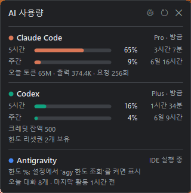
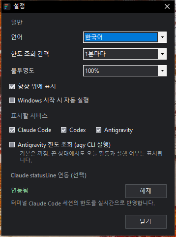
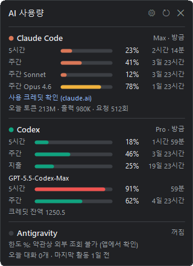

# AI Usage Tracker

[English](README.md) | [한국어](README.ko.md) | **日本語** | [简体中文](README.zh-CN.md)

**Claude Code** と **Codex** のプラン上限をどれだけ使ったか、そして今日の **Antigravity** の活動を画面上に表示する、Windows 10/11 向けのフローティングウィジェットです。インストーラーやランタイムは不要で、実行ファイル 1 つ（約 90KB）で動くポータブルアプリです。

<p>
  
  
</p>

## 機能

- サービスごとの 5 時間 / 週間上限の使用率とリセットまでの残り時間
- 上位プランのモデル専用上限（例: 週間 Opus、Codex のモデル専用バケット）も行を追加して表示
- ローカル記録から Claude Code の今日のトークン使用量と Antigravity の活動を表示
- ログアウトを検出し、クリック 1 回で公式ログインコマンドをターミナルで実行
- 常に手前に表示、ドラッグで移動、トレイに隠す、Windows 起動時に自動実行
- 한국어 / English / 日本語 / 简体中文 の UI
- 各ツールの公式 CLI とローカルファイルのみを使用します。認証トークンを読まず、サービスの API を直接呼び出しません。

## インストール

1. **Releases** から `AIUsageTracker-<バージョン>-win.zip` をダウンロードし、任意の場所に展開します。
2. `AIUsageTracker.exe` を実行すると、画面右上にウィジェットが表示されます。
3. 設定は exe の隣の `data\` フォルダーに保存されるので、フォルダーごと移動できます。

> exe にはコード署名がないため、初回起動時に Windows SmartScreen の警告が出ることがあります。**詳細情報 → 実行** を選ぶか、[ソースからビルド](#ソースからビルド)してください。

**必要なもの**

| | 用途 | 備考 |
|---|---|---|
| Windows 10 / 11 | すべて | 標準搭載の .NET Framework 4.8 を使用 |
| [Claude Code](https://code.claude.com) CLI（ログイン済み） | Claude の上限 | Pro / Max / Team プラン。API キー利用者はトークン合計のみ |
| [Codex CLI](https://github.com/openai/codex)（`npm i -g @openai/codex`、ログイン済み） | Codex の上限 | |
| Antigravity（IDE または `agy` CLI） | Antigravity の活動 | 上限は表示しません（[理由](#antigravity-の上限を表示しない理由)） |

CLI がないサービスは「CLI が見つかりません」と表示されるだけで、他は通常どおり動作します。

## 使い方

- **ヘッダーのボタン:** ⚙ 設定、⟳ 今すぐ更新、✕ トレイに隠す（トレイアイコンをクリックで再表示）
- **右クリック**（ウィジェットまたはトレイ）: 更新、設定、データフォルダーを開く、終了
- バーは 75% 以上でオレンジ、90% 以上で赤になります。% はすべて**使用済み**の割合です。
- Claude Code の欄の **使用クレジットを確認 (claude.ai)** を押すと、ブラウザーで claude.ai の使用量ページが開きます。[Claude Code の使用クレジット](#claude-code-の使用クレジット)を参照してください。

### 設定 (⚙)

変更はすぐに反映されます。

| 項目 | 説明 |
|---|---|
| 言語 | 한국어 / English / 日本語 / 中文(简体)。初回は Windows の表示言語に従います。 |
| 上限の確認間隔 | 1〜30 分（既定 5 分）。CLI を照会する間隔です。ローカルのトークン / 活動情報は 20〜30 秒ごとに更新されます。 |
| 不透明度 | 100〜60%。低いほど透明になります。 |
| 常に手前に表示 | 他のウィンドウより前面に固定 |
| Windows 起動時に自動実行 | `HKCU\...\Run` に登録 / 削除。管理者権限は不要 |
| 表示するサービス | サービスごとの表示切り替え。オフのサービスは照会しません。 |
| Claude statusLine 連携 | ターミナルのセッションからリアルタイム更新（任意）。下記参照 |

## データの取得方法

| サービス | データ | 取得元 |
|---|---|---|
| Claude Code | ログイン状態、プラン | `claude auth status --json` |
| Claude Code | 上限 | `claude -p "/usage" --output-format json --no-session-persistence`（モデルを呼び出さないローカルコマンド） |
| Claude Code | 今日のトークン | `~/.claude/projects/**/*.jsonl`（読み取り専用） |
| Codex | ログイン状態、上限、プラン、クレジット | `codex app-server` JSON-RPC: `account/read`、`account/rateLimits/read` |
| Antigravity | 今日の会話数、実行状態 | `~/.gemini/antigravity*/conversations` のファイル時刻、プロセス一覧 |

**行わないこと:** `~/.claude/.credentials.json`、`~/.codex/auth.json` などの認証情報の読み取り、サービスのサーバーへの直接リクエスト、外部へのデータ送信。ネットワーク通信はすべて公式 CLI が行います。

安全策: `/usage` がローカルコマンドではなくプロンプトとして処理された場合（古い CLI など）、使用量を消費しないよう以降の呼び出しを止めます。

## ログアウト時

| サービス | 検出方法 | 表示 | ログインコマンド |
|---|---|---|---|
| Claude Code | `loggedIn: false` | **ログインが必要** + リンク | `claude auth login` |
| Codex | `account: null` | **ログインが必要** + リンク | `codex login` |

**クリックしてログイン: …** を押すと、そのコマンドを実行するターミナルが開きます。その後 10 分間は 15 秒ごとに再確認するので、ログインが終わるとすぐに上限が表示されます。

ウィジェットが確認するのは **CLI** のログインです。Codex はアプリと CLI でログインを共有しますが、Claude デスクトップアプリは Claude Code とは別のログインです。

## 上位プラン

CLI が返す上限は数に関係なくすべて表示します。

- **Claude Code:** `Current week (Sonnet only)`（Max/Team）、`Current week (Opus 4.6)` のようなモデル別の行
- **Codex:** `rateLimitsByLimitId` の追加バケット（例: フロンティアモデル）を小見出し付きの別行で、支出上限の行



*各 CLI の出力形式に沿った模擬レスポンスで描画した画面です。実際の上位プランのアカウントでは確認していません。*

## Claude statusLine 連携（任意）

設定 → **連携** を押すと、`~/.claude/settings.json` にウィジェットを Claude Code の `statusLine` コマンドとして登録します（`settings.json.aiusagetracker.bak` にバックアップ）。ターミナルで Claude Code を使っている間:

- 次の照会を待たずに 5 時間 / 週間の上限がすぐ更新されます。
- ターミナル下部に `Opus 5.5 · 5h 51% (3時間31分) · 7d 7% · ctx 42%` のようなステータス行が表示されます。

Claude デスクトップアプリだけを使っている場合は効果がありません。**解除** すると以前の statusLine が復元されます。

## Claude Code の使用クレジット

公式 CLI の非対話モードの `/usage` 出力にはクレジット残高と支出履歴が含まれないため、ウィジェットには表示しません。代わりに、サブスクリプションでログインしている場合は [claude.ai/settings/usage](https://claude.ai/settings/usage) を既定のブラウザーで開くリンクを表示します。ウィジェットがこのページを読み取ったり、リクエストを送ったりすることはありません。

## Antigravity の上限を表示しない理由

Google の [Antigravity 追加利用規約](https://antigravity.google/terms)第 6 条は、サードパーティのソフトウェアでサービスにアクセスすることを規約違反とし、[Antigravity FAQ](https://antigravity.google/docs/faq/) はコンシューマープランでは他のアプリが `agy` をラップして実行することをサポートしていないと案内しています。そのため、このウィジェットは **`agy` を実行せず、Antigravity と通信もしません**。`~/.gemini/antigravity*/conversations` のファイル時刻とローカルのプロセス一覧だけを読み、今日の活動を表示します。上限は Antigravity 本体で確認してください（CLI の `/usage`、IDE のモデル選択メニュー）。

## トラブルシューティング

```powershell
AIUsageTracker.exe --diagnose | Out-String
AIUsageTracker.exe --diagnose --lang ja | Out-String
```

`--diagnose` はウィジェットと同じコードで各サービスを 1 回照会し、結果を出力します。メールアドレスやアカウント ID は出力しません。

CLI が標準以外の場所にある場合は、環境変数 `AI_USAGE_TRACKER_CLAUDE_PATH`、`AI_USAGE_TRACKER_CODEX_PATH` にフルパスを指定してください。

## ソースからビルド

```bat
build.cmd
```

Windows に付属する C# コンパイラー（`csc.exe`、.NET Framework 4.x）で `src\*.cs` を `dist\AIUsageTracker.exe` にコンパイルします。追加のダウンロードは不要です。

## 免責事項

非公式の個人プロジェクトであり、Anthropic、OpenAI、Google とは関係がなく、承認や後援も受けていません。Claude、Claude Code、Codex、Antigravity は各所有者の商標で、互換性の説明のためにのみ使用しています。CLI の出力形式はいつでも変わる可能性があります。各サービスの規約に沿ってご利用ください。
