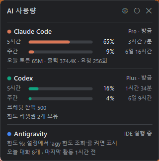
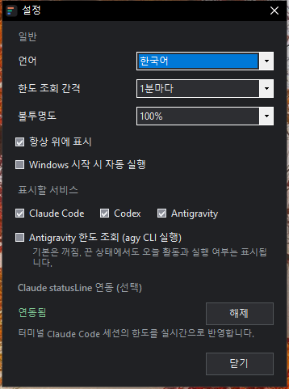
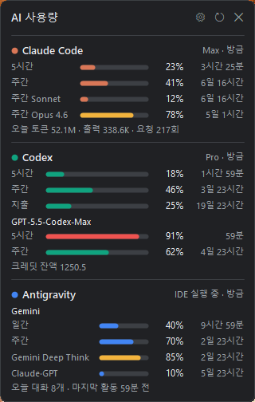

# AI Usage Tracker

[English](README.md) | **한국어** | [日本語](README.ja.md) | [简体中文](README.zh-CN.md)

**Claude Code**, **Codex**, **Antigravity** 플랜 한도를 얼마나 썼는지 화면 위에 띄워 보여 주는 Windows 10/11용 위젯입니다. 설치 프로그램이나 런타임 설치 없이 실행 파일 하나(약 90KB)로 동작하는 포터블 앱입니다.

<p>
  
  
</p>

## 기능

- 서비스별 5시간/주간 한도 사용률과 리셋까지 남은 시간
- 상위 플랜의 모델 전용 한도(예: 주간 Opus, Codex 모델 전용 버킷)도 줄을 추가해 표시
- 로컬 기록으로 Claude Code 오늘 토큰 사용량, Antigravity 활동 표시
- 로그아웃 감지, 클릭 한 번으로 공식 로그인 명령을 터미널에서 실행
- 항상 위에 표시, 드래그 이동, 트레이로 숨기기, Windows 시작 시 자동 실행
- 한국어, English, 日本語, 简体中文 UI
- 각 도구의 공식 CLI와 로컬 파일만 사용합니다. 인증 토큰을 읽지 않고, 서비스 API를 직접 호출하지 않습니다.

## 설치

1. **Releases**에서 `AIUsageTracker-<버전>-win.zip`을 받아 원하는 곳에 압축을 풉니다.
2. `AIUsageTracker.exe`를 실행하면 화면 오른쪽 위에 위젯이 뜹니다.
3. 설정은 exe 옆 `data\` 폴더에 저장되므로 폴더째 옮겨도 됩니다.

> 코드 서명이 없는 exe라서 처음 실행할 때 Windows SmartScreen 경고가 뜰 수 있습니다. **추가 정보 → 실행**을 누르거나 [직접 빌드](#소스에서-빌드)해서 쓰세요.

**필요한 것**

| | 용도 | 비고 |
|---|---|---|
| Windows 10 / 11 | 전체 | 기본 내장 .NET Framework 4.8 사용 |
| [Claude Code](https://code.claude.com) CLI (로그인) | Claude 한도 | Pro / Max / Team 플랜. API 키 사용자는 토큰 합계만 표시 |
| [Codex CLI](https://github.com/openai/codex) (`npm i -g @openai/codex`, 로그인) | Codex 한도 | |
| Antigravity / `agy` CLI | Antigravity 활동 (한도는 선택, 아래 참고) | |

CLI가 없는 서비스는 "CLI를 찾을 수 없음"만 표시되고, 나머지는 그대로 동작합니다.

## 사용법

- **헤더 버튼:** ⚙ 설정, ⟳ 지금 새로고침, ✕ 트레이로 숨기기 (트레이 아이콘을 클릭하면 다시 표시)
- **우클릭** (위젯 또는 트레이): 새로고침, 설정, 데이터 폴더 열기, 종료
- 막대는 75% 이상 주황, 90% 이상 빨강입니다. 모든 %는 **사용한 비율**입니다.

### 설정 (⚙)

바꾸는 즉시 적용됩니다.

| 항목 | 설명 |
|---|---|
| 언어 | 한국어 / English / 日本語 / 中文(简体). 처음에는 Windows 표시 언어를 따릅니다. |
| 한도 조회 간격 | 1~30분 (기본 5분). CLI 조회 주기입니다. 로컬 토큰/활동 정보는 20~30초마다 갱신됩니다. |
| 불투명도 | 100~60%. 낮을수록 더 투명합니다. |
| 항상 위에 표시 | 다른 창 위에 고정 |
| Windows 시작 시 자동 실행 | `HKCU\...\Run`에 등록/삭제. 관리자 권한 불필요 |
| 표시할 서비스 | 서비스별 표시 여부. 끈 서비스는 조회하지 않습니다. |
| Antigravity 한도 조회 | **기본 꺼짐.** [아래](#antigravity-한도-조회는-선택) 참고 |
| Claude statusLine 연동 | 터미널 세션에서 실시간 갱신 (선택). 아래 참고 |

## 데이터를 가져오는 방식

| 서비스 | 데이터 | 출처 |
|---|---|---|
| Claude Code | 로그인 여부, 플랜 | `claude auth status --json` |
| Claude Code | 한도 | `claude -p "/usage" --output-format json --no-session-persistence` (모델을 호출하지 않는 로컬 명령) |
| Claude Code | 오늘 토큰 | `~/.claude/projects/**/*.jsonl` (읽기 전용) |
| Codex | 로그인 여부, 한도, 플랜, 크레딧 | `codex app-server` JSON-RPC: `account/read`, `account/rateLimits/read` |
| Antigravity | 오늘 대화 수, 실행 여부 | `~/.gemini/antigravity*/conversations` 파일 시각, 프로세스 목록 |
| Antigravity | 한도 (선택) | `agy -p "/usage" --output-format json` (에이전트 턴 없음, 할당량 사용 없음) |

**하지 않는 것:** `~/.claude/.credentials.json`, `~/.codex/auth.json` 등 인증 정보 읽기, 서비스 서버에 직접 요청, 데이터 외부 전송. 네트워크 통신은 모두 공식 CLI가 합니다.

안전장치: `/usage`가 로컬 명령이 아니라 프롬프트로 처리되면(구버전 CLI 등) 사용량을 쓰지 않도록 이후 호출을 멈춥니다.

## 로그아웃 상태

| 서비스 | 감지 방법 | 위젯 표시 | 로그인 명령 |
|---|---|---|---|
| Claude Code | `loggedIn: false` | **로그인 필요** + 링크 | `claude auth login` |
| Codex | `account: null` | **로그인 필요** + 링크 | `codex login` |
| Antigravity (켰을 때) | "not logged in" / "authentication required" | **로그인 필요** + 링크 | `agy` |

**클릭하여 로그인: …** 을 누르면 그 명령을 실행하는 터미널이 열립니다. 이후 10분 동안 15초마다 다시 확인하므로, 로그인이 끝나면 바로 한도가 표시됩니다.

위젯이 보는 것은 **CLI**의 로그인입니다. Codex는 앱과 CLI가 로그인을 공유하지만, Claude 데스크톱 앱과 Antigravity IDE는 CLI와 로그인이 따로입니다.

## 상위 플랜

CLI가 알려 주는 한도를 개수에 상관없이 모두 표시합니다.

- **Claude Code:** `Current week (Sonnet only)` (Max/Team), `Current week (Opus 4.6)` 같은 모델별 줄
- **Codex:** `rateLimitsByLimitId`의 추가 버킷(예: 프런티어 모델)을 소제목과 함께 별도 줄로, 지출 한도 줄
- **Antigravity:** 한도가 여러 개인 그룹(일간+주간)을 소제목으로



*각 CLI의 출력 형식을 따른 가짜 응답으로 그린 화면입니다. 실제 상위 플랜 계정으로는 확인하지 않았습니다.*

## Claude statusLine 연동 (선택)

설정 → **연동**을 누르면 `~/.claude/settings.json`에 위젯을 Claude Code의 `statusLine` 명령으로 등록합니다 (`settings.json.aiusagetracker.bak`으로 백업). 터미널에서 Claude Code를 쓰는 동안:

- 다음 조회를 기다리지 않고 5시간/주간 한도가 바로 갱신됩니다.
- 터미널 아래쪽에 `Opus 5.5 · 5h 51% (3시간 31분) · 7d 7% · ctx 42%` 같은 상태줄이 나옵니다.

Claude 데스크톱 앱만 쓴다면 효과가 없습니다. **해제**하면 이전에 쓰던 statusLine이 복원됩니다.

## Antigravity 한도 조회는 선택

Google의 Antigravity FAQ는 소비자 플랜에서 다른 앱이 `agy`를 감싸 실행하는 것을 지원하지 않는다고 안내하고, [추가 약관](https://antigravity.google/terms) 6조는 서드파티 도구로 서비스에 접근하면 계정이 정지될 수 있다고 명시합니다. 위젯은 읽기 전용 `/usage` 명령만 실행하지만, 이 기능은 **기본으로 꺼져 있습니다**. 켤 때 경고가 먼저 나오며, 켜는 것은 본인 판단입니다. 꺼 두어도 `agy`를 실행하지 않고 로컬 파일로 오늘 활동은 표시합니다.

## 문제 해결

```powershell
AIUsageTracker.exe --diagnose | Out-String
AIUsageTracker.exe --diagnose --lang en | Out-String
```

`--diagnose`는 위젯과 같은 코드로 각 서비스를 한 번 조회해 결과를 출력합니다. 이메일이나 계정 ID는 출력하지 않습니다.

CLI가 표준 위치에 없으면 `AI_USAGE_TRACKER_CLAUDE_PATH`, `AI_USAGE_TRACKER_CODEX_PATH`, `AI_USAGE_TRACKER_AGY_PATH` 환경 변수에 전체 경로를 지정하세요.

## 소스에서 빌드

```bat
build.cmd
```

Windows에 포함된 C# 컴파일러(`csc.exe`, .NET Framework 4.x)로 `src\*.cs`를 `dist\AIUsageTracker.exe`로 컴파일합니다. 따로 받을 것이 없습니다.

## 고지

비공식 개인 프로젝트이며 Anthropic, OpenAI, Google과 관련이 없고 이들의 보증이나 후원을 받지 않습니다. Claude, Claude Code, Codex, Antigravity는 각 소유자의 상표이며 호환성을 설명하는 용도로만 사용했습니다. CLI 출력 형식은 언제든 바뀔 수 있습니다. 각 서비스 약관에 맞게 사용하세요.
