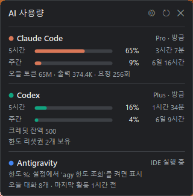
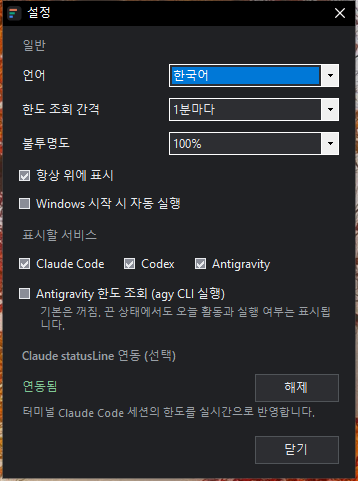
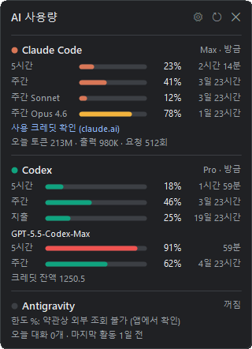

# AI Usage Tracker

**English** | [한국어](README.ko.md) | [日本語](README.ja.md) | [简体中文](README.zh-CN.md)

A small floating widget for Windows 10/11 that shows how much of your **Claude Code** and **Codex** plan limits you have used, plus today's **Antigravity** activity. It is a single portable `.exe` (about 90 KB) with no installer and no runtime to install.

<p>
  
  
</p>

## Features

- 5-hour / weekly limit usage with time until reset, for each service
- Model-specific limits on higher-tier plans (e.g. weekly Opus, a Codex model bucket), shown as extra rows
- Today's Claude Code token usage and Antigravity activity from local logs
- Sign-in detection, with a one-click link that opens the official login command in a terminal
- Always on top, drag to move, hide to tray, start with Windows
- UI in English, Korean, Japanese, and Simplified Chinese
- Uses only each tool's official CLI and local files. It never reads auth tokens and never calls service APIs on its own.

## Install

1. Download `AIUsageTracker-<version>-win.zip` from **Releases** and extract it anywhere.
2. Run `AIUsageTracker.exe`. The widget appears in the top-right corner.
3. Settings are saved in a `data\` folder next to the exe, so you can move the folder freely.

> The exe is not code-signed, so Windows SmartScreen may warn you the first time. Choose **More info → Run anyway**, or [build it yourself](#build-from-source).

**Requirements**

| | Needed for | Notes |
|---|---|---|
| Windows 10 / 11 | Everything | Uses the built-in .NET Framework 4.8 |
| [Claude Code](https://code.claude.com) CLI, signed in | Claude limits | Pro / Max / Team plan. API-key users only see token totals. |
| [Codex CLI](https://github.com/openai/codex) (`npm i -g @openai/codex`), signed in | Codex limits | |
| Antigravity (IDE or `agy` CLI) | Antigravity activity | Limits are not shown ([why](#why-antigravity-limits-are-not-shown)) |

A service whose CLI is missing just shows a "CLI not found" line; the others keep working.

## Usage

- **Header buttons:** ⚙ settings, ⟳ refresh now, ✕ hide to tray (click the tray icon to show it again)
- **Right-click** the widget or tray icon: refresh, settings, open data folder, exit
- Bars turn orange at 75% and red at 90%. All percentages are **used** amounts.
- **Check usage credits (claude.ai)** in the Claude Code section opens claude.ai's usage page in your browser. See [Claude Code usage credits](#claude-code-usage-credits).

### Settings (⚙)

Changes apply immediately.

| Setting | Description |
|---|---|
| Language | 한국어 / English / 日本語 / 中文(简体). Defaults to the Windows display language. |
| Limit check interval | 1–30 min (default 5). How often the CLIs are queried. Local token/activity data refreshes every 20–30 s. |
| Opacity | 100–60%. Lower is more transparent. |
| Always on top | Keep the widget above other windows |
| Start with Windows | Adds/removes an entry under `HKCU\...\Run`. No admin rights needed. |
| Services | Show or hide each service. Hidden services are not queried. |
| Claude statusLine | Optional live updates from terminal sessions. See below. |

## How it gets the data

| Service | Data | Source |
|---|---|---|
| Claude Code | Signed in?, plan | `claude auth status --json` |
| Claude Code | Limits | `claude -p "/usage" --output-format json --no-session-persistence` (a local command, no model call) |
| Claude Code | Today's tokens | `~/.claude/projects/**/*.jsonl` (read-only) |
| Codex | Signed in?, limits, plan, credits | `codex app-server` JSON-RPC: `account/read`, `account/rateLimits/read` |
| Antigravity | Today's conversations, running state | `~/.gemini/antigravity*/conversations` file times, process list |

**What it never does:** read `~/.claude/.credentials.json`, `~/.codex/auth.json`, or any other credential; send requests to service servers itself; send any data anywhere. All network traffic is made by the official CLIs.

Safety guard: if a CLI ever treats `/usage` as a prompt instead of a local command (e.g. an old version), the widget stops calling it so no usage is spent.

## Signed out

| Service | Detected by | Widget shows | Sign in with |
|---|---|---|---|
| Claude Code | `loggedIn: false` | **Sign-in needed** + link | `claude auth login` |
| Codex | `account: null` | **Sign-in needed** + link | `codex login` |

Click **Click to sign in: …** to open a terminal running that command. After clicking, the widget re-checks every 15 s for 10 minutes and shows limits as soon as you are signed in.

The widget checks the **CLI** login. Codex shares its login between the app and CLI; the Claude desktop app has a separate login from Claude Code.

## Higher-tier plans

Every limit a CLI reports is shown, however many there are:

- **Claude Code:** `Current week (Sonnet only)` (Max/Team) and per-model rows such as `Current week (Opus 4.6)`
- **Codex:** extra buckets in `rateLimitsByLimitId` (e.g. a frontier model) as a subheading with their own rows, plus a spend-cap row



*Rendered from simulated responses that follow each CLI's output format; not verified with a real high-tier account.*

## Claude statusLine (optional)

Settings → **Connect** registers the widget as Claude Code's `statusLine` command in `~/.claude/settings.json` (a backup is saved as `settings.json.aiusagetracker.bak`). While you use Claude Code in a terminal:

- The widget updates 5-hour/weekly limits instantly instead of waiting for the next check.
- A status line such as `Opus 5.5 · 5h 51% (3h 31m) · 7d 7% · ctx 42%` appears at the bottom of the terminal.

It has no effect if you only use the Claude desktop app. **Disconnect** restores any statusLine you had before.

## Claude Code usage credits

The widget doesn't show your Claude Code credit balance or spending history, because the official CLI's `/usage` output in non-interactive mode doesn't include them. Instead, signed-in subscribers get a link that opens [claude.ai/settings/usage](https://claude.ai/settings/usage) in the default browser. The widget doesn't read that page or send it any request.

## Why Antigravity limits are not shown

Google's [Antigravity Additional Terms](https://antigravity.google/terms) (Section 6) treat using third-party software to access the service as a breach, and the [Antigravity FAQ](https://antigravity.google/docs/faq/) says wrapping `agy` inside third-party applications is not supported on consumer plans. So this widget **never runs `agy` or talks to Antigravity**. It only reads file timestamps in `~/.gemini/antigravity*/conversations` and the local process list to show today's activity. Check your Antigravity limits in Antigravity itself (`/usage` in the CLI, or the model picker in the IDE).

## Troubleshooting

```powershell
AIUsageTracker.exe --diagnose | Out-String
AIUsageTracker.exe --diagnose --lang en | Out-String
```

`--diagnose` queries each service once with the same code as the widget and prints the result. It does not print your email or account IDs.

If a CLI is installed in a non-standard location, set `AI_USAGE_TRACKER_CLAUDE_PATH` or `AI_USAGE_TRACKER_CODEX_PATH` to its full path.

## Build from source

```bat
build.cmd
```

Compiles `src\*.cs` into `dist\AIUsageTracker.exe` with the C# compiler that ships with Windows (`csc.exe`, .NET Framework 4.x). Nothing needs to be downloaded.

## Contributors

- [@devshin-91](https://github.com/devshin-91): idea, requirements, testing
- **Claude** (Anthropic): design and implementation, pair-programmed in [Claude Code](https://claude.com/claude-code)

## Disclaimer

This is an unofficial, independent project. It is not affiliated with, endorsed by, or sponsored by Anthropic, OpenAI, or Google. Claude, Claude Code, Codex, and Antigravity are trademarks of their respective owners and are used here only to describe compatibility. Output formats of the CLIs may change at any time. Make sure your use complies with each service's terms.
