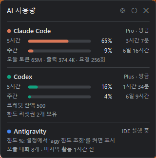
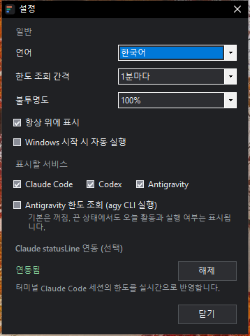
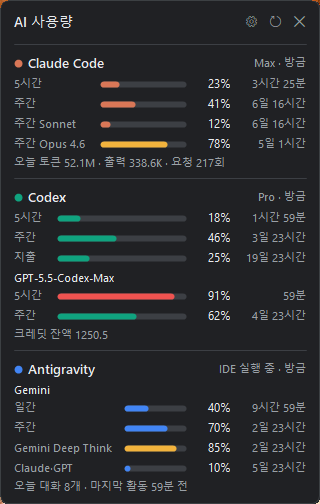

# AI Usage Tracker

[English](README.md) | [한국어](README.ko.md) | [日本語](README.ja.md) | **简体中文**

一个适用于 Windows 10/11 的悬浮小组件，在屏幕上显示 **Claude Code**、**Codex** 和 **Antigravity** 的套餐限额已用了多少。无需安装程序或运行时，只有一个可执行文件（约 90KB），属于便携式应用。

<p>
  
  
</p>

## 功能

- 各服务 5 小时 / 每周限额的使用率，以及距离重置的剩余时间
- 高级套餐的模型专属限额（如每周 Opus、Codex 模型专属额度桶）会以额外的行显示
- 根据本地记录显示 Claude Code 今日 token 用量和 Antigravity 活动
- 检测登出状态，点击一次即可在终端中运行官方登录命令
- 始终置顶、拖动移动、隐藏到托盘、开机自动启动
- 界面支持 한국어 / English / 日本語 / 简体中文
- 只使用各工具的官方 CLI 和本地文件。不读取认证令牌，也不会自行调用服务 API。

## 安装

1. 从 **Releases** 下载 `AIUsageTracker-<版本>-win.zip`，解压到任意位置。
2. 运行 `AIUsageTracker.exe`，小组件会出现在屏幕右上角。
3. 设置保存在 exe 旁边的 `data\` 文件夹中，可以整个文件夹一起移动。

> exe 没有代码签名，首次运行时 Windows SmartScreen 可能会提示警告。请选择 **更多信息 → 仍要运行**，或[从源码构建](#从源码构建)。

**运行要求**

| | 用途 | 说明 |
|---|---|---|
| Windows 10 / 11 | 全部 | 使用系统自带的 .NET Framework 4.8 |
| [Claude Code](https://code.claude.com) CLI（已登录） | Claude 限额 | Pro / Max / Team 套餐。API 密钥用户只显示 token 合计 |
| [Codex CLI](https://github.com/openai/codex)（`npm i -g @openai/codex`，已登录） | Codex 限额 | |
| Antigravity / `agy` CLI | Antigravity 活动（限额为可选，见下文） | |

缺少 CLI 的服务只会显示“未找到 CLI”，其他服务照常工作。

## 使用方法

- **标题栏按钮：** ⚙ 设置、⟳ 立即刷新、✕ 隐藏到托盘（点击托盘图标可重新显示）
- **右键**（小组件或托盘）：刷新、设置、打开数据文件夹、退出
- 进度条在 75% 以上变为橙色，90% 以上变为红色。所有百分比均为**已用**比例。

### 设置 (⚙)

更改会立即生效。

| 项目 | 说明 |
|---|---|
| 语言 | 한국어 / English / 日本語 / 中文(简体)。首次运行时跟随 Windows 显示语言。 |
| 限额检查间隔 | 1–30 分钟（默认 5 分钟）。查询 CLI 的频率。本地 token / 活动信息每 20–30 秒刷新一次。 |
| 不透明度 | 100–60%。数值越低越透明。 |
| 始终置顶 | 固定在其他窗口之上 |
| 开机自动启动 | 在 `HKCU\...\Run` 中添加 / 删除。无需管理员权限 |
| 显示的服务 | 按服务切换显示。关闭的服务不会被查询。 |
| Antigravity 限额查询 | **默认关闭。**见[下文](#antigravity-限额查询为可选项) |
| Claude statusLine 连接 | 从终端会话实时更新（可选）。见下文 |

## 数据来源

| 服务 | 数据 | 来源 |
|---|---|---|
| Claude Code | 登录状态、套餐 | `claude auth status --json` |
| Claude Code | 限额 | `claude -p "/usage" --output-format json --no-session-persistence`（不调用模型的本地命令） |
| Claude Code | 今日 token | `~/.claude/projects/**/*.jsonl`（只读） |
| Codex | 登录状态、限额、套餐、额度 | `codex app-server` JSON-RPC：`account/read`、`account/rateLimits/read` |
| Antigravity | 今日对话数、运行状态 | `~/.gemini/antigravity*/conversations` 的文件时间、进程列表 |
| Antigravity | 限额（可选） | `agy -p "/usage" --output-format json`（不启动代理回合，不消耗配额） |

**不会做的事：** 读取 `~/.claude/.credentials.json`、`~/.codex/auth.json` 等认证信息；直接向服务的服务器发送请求；向外部发送任何数据。所有网络通信都由官方 CLI 完成。

安全保护：如果 `/usage` 被当作提示词而不是本地命令处理（例如旧版 CLI），小组件会停止后续调用，避免消耗用量。

## 登出状态

| 服务 | 检测方式 | 显示 | 登录命令 |
|---|---|---|---|
| Claude Code | `loggedIn: false` | **需要登录** + 链接 | `claude auth login` |
| Codex | `account: null` | **需要登录** + 链接 | `codex login` |
| Antigravity（开启时） | "not logged in" / "authentication required" | **需要登录** + 链接 | `agy` |

点击 **点击登录: …** 会打开一个运行该命令的终端。之后 10 分钟内每 15 秒重新检查一次，登录完成后会立即显示限额。

小组件检查的是 **CLI** 的登录状态。Codex 的应用和 CLI 共享登录，而 Claude 桌面应用和 Antigravity IDE 与各自的 CLI 是分开登录的。

## 高级套餐

CLI 返回的限额无论有多少都会全部显示：

- **Claude Code：** `Current week (Sonnet only)`（Max/Team），以及 `Current week (Opus 4.6)` 这样的按模型的行
- **Codex：** `rateLimitsByLimitId` 中的额外额度桶（如前沿模型）以小标题加单独的行显示，另有支出限额行
- **Antigravity：** 包含多个限额的分组（每日 + 每周）以小标题显示



*此画面由遵循各 CLI 输出格式的模拟响应渲染，尚未用真实的高级套餐账号验证。*

## Claude statusLine 连接（可选）

在设置中点击 **连接**，会在 `~/.claude/settings.json` 中把小组件注册为 Claude Code 的 `statusLine` 命令（备份为 `settings.json.aiusagetracker.bak`）。在终端中使用 Claude Code 时：

- 5 小时 / 每周限额会立即更新，无需等待下一次查询。
- 终端底部会显示类似 `Opus 5.5 · 5h 51% (3小时31分) · 7d 7% · ctx 42%` 的状态行。

如果只使用 Claude 桌面应用则没有效果。点击 **断开** 会恢复之前的 statusLine。

## Antigravity 限额查询为可选项

Google 的 Antigravity FAQ 表示，消费者套餐不支持由第三方应用封装运行 `agy`；[附加条款](https://antigravity.google/terms)第 6 条也写明，使用第三方工具访问服务可能导致账号被停用。虽然小组件只运行只读的 `/usage` 命令，但此功能**默认关闭**。开启时会先显示警告，是否开启由你自行决定。即使关闭，小组件也会在不运行 `agy` 的情况下，从本地文件显示今日活动。

## 故障排查

```powershell
AIUsageTracker.exe --diagnose | Out-String
AIUsageTracker.exe --diagnose --lang zh | Out-String
```

`--diagnose` 会用与小组件相同的代码查询每个服务一次并输出结果，不会输出邮箱或账号 ID。

如果 CLI 安装在非标准位置，请在环境变量 `AI_USAGE_TRACKER_CLAUDE_PATH`、`AI_USAGE_TRACKER_CODEX_PATH` 或 `AI_USAGE_TRACKER_AGY_PATH` 中设置完整路径。

## 从源码构建

```bat
build.cmd
```

使用 Windows 自带的 C# 编译器（`csc.exe`，.NET Framework 4.x）把 `src\*.cs` 编译为 `dist\AIUsageTracker.exe`，无需下载任何东西。

## 免责声明

这是一个非官方的个人项目，与 Anthropic、OpenAI、Google 无关，也未获得其认可或赞助。Claude、Claude Code、Codex、Antigravity 是其各自所有者的商标，此处仅用于说明兼容性。CLI 的输出格式可能随时变化。请确保你的使用方式符合各服务的条款。
